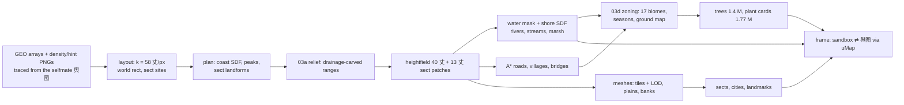

# 01 · Overview: how the Xiuxian Flying Map works

The demo (`demo/index.html`, ~15 000 lines, one ES module on Three.js r170) is a **living 青绿山水 map of the 凡人修仙传
human realm** — 天南 / 溪国 / 云梦山 and the 天道盟 east — that you fly over as a streak of light (遁光), and that folds
into a painted 舆图 at the press of a key. Everything you see is generated at boot from a small amount of hand-placed
geography; there are only a handful of optional image/model assets.

This chapter is the map of the whole system. The six chapters after it go deep, section by section, with line numbers:

| chapter | covers (index.html sections) |
|---|---|
| [02 · World data & coordinates](02-world-data-and-coordinates.md) | 00 GEO, 01 CONFIG + layout + coordinates, 02 places/assets, 03 world planning |
| [03 · Terrain generation](03-terrain-generation.md) | 03a mountains (drainage), 03b rivers/roads/villages, 03c seasons & plants, 03d zoning, 03e/03l landforms |
| [04 · Rendering: terrain, water, objects](04-rendering-terrain-water-objects.md) | 04 land & shading, 05 water, 06 objects & trees |
| [05 · Sects, architecture, cities](05-sects-architecture-cities.md) | 06b–06bk sects & architecture kit, 06c spirit lights, 06d ornaments, 06e cities |
| [06 · Clouds, light, post, life](06-clouds-light-post-life.md) | 07 clouds / cloud sea / god rays, 08 遁光 + figure, 09 post, 11 ambience, NPCs, life |
| [07 · UI, flight, camera, the 舆图](07-ui-flight-camera-map.md) | HTML/CSS, 10 舆图 painting, 12 flight & modes, 13 debug, 14 boot & loop |

And for the port: [godot/](godot/README.md).

---

## 1. Running the demo

```bash
cd demo && python3 -m http.server 8000      # any static server; file:// will not load the JSON/GLB assets
open http://localhost:8000/                  # ?skip skips the intro, ?lite halves the render scale, ?test stops the loop
```
The page imports `three@0.170.0` from jsDelivr (import map at the top of the module) and the two fonts from Google
Fonts; everything else is local. It boots in ~25–45 s of world generation on a desktop (`YM boot ms …` in the console),
then the intro plays.

`window.__ym` is a test hook (L14975): `state()`, `fly(x, z, A)`, `flyTo(id)`, `mapNow()`, `select(name)`, `set(key, v)`,
`render(n)` (with `?test`), plus samplers `dev.hAt / waterAt / sdAt …`. `tools/export-world` drives exactly this hook.

### Files in `demo/`

| file | what | if missing |
|---|---|---|
| `index.html` | the whole program (CSS, DOM, ~14 700 lines of JS, two embedded PNG data maps) | — |
| `hotspots.json` | base-map pixel positions of 8 places (lets you re-pin places without editing code) | built-in positions |
| `details.json` | which info cards have a painting | no paintings |
| `card_*.jpg` | the paintings shown in the info card (图中所绘) | text only |
| `cloud.png`, `formation.png` | brush textures for card clouds and formation rings | procedural fallbacks |
| `assets/ym_pack.json` | **a standard glTF 2.0** (embedded buffer) — 79 models from *Stylized Chinese Lost Temple* (Stylarts) and *Meadow Environment* (ANGRY MESH), via `kk20054/ThreeJS-Stylized-World-Assets` | procedural stand-ins |
| `assets/tex/*` | the 66 textures of that pack | |
| `assets/eco.json`, `eco_albedo.webp`, `eco_normal.webp` | 73 Meadow plants as impostor-card atlases (1.77 M cards are scattered) | no ground plants |
| `assets/ground_*.jpg` | 5 painted ground detail tiles (grass, dry, snow, cliff, mud) | flat ground |

> **Asset licence.** The pack and eco models are commercial assets; the copyright line inside `ym_pack.json` says
> "rights stay with the original packages". Keep the repository private unless your licences allow redistribution.

---

## 2. The core idea: the map *is* the world

1. **Geography comes from a reference map.** The coastline, the islands of 七灵岛, the two great rivers, the 天道盟 border
   and 13 place "pins" (the six sects plus mountains, cities, 七灵岛 and the vortex, L286) were traced from screenshots of
   the selfmate 人界舆图 and stored as flat arrays in `GEO` (L277–310), in *base-map pixels* of one 1490×812 screenshot.
   Two 757×460 PNGs embedded as base64 give the **mountain density** and a **hint** map (aridity, woods) — see
   [`img/density.png`](img/density.png), [`img/hint.png`](img/hint.png).
2. **One scale ties it to time.** `CONFIG.layout` says "flying from 古剑门 to 落云宗 at cruising speed takes 62 s". With the
   cruise speed 0.12 × 1650 = 198 丈/s that fixes **k = 58.06 丈 per base-map pixel**; the origin is the centroid of the
   three 云梦 sects. `world = (px − origin) · k` → a world of **131 800 × 80 100 丈** (`computeLayout`, L394–434).
3. **The terrain is grown, not sculpted.** Mountains appear where the density map says, then a drainage model carves
   valleys (03a), rivers follow the drainage and the designed great rivers, roads are A*-routed between sect gates and
   cities through the valleys (03b), every sect gets a hand-tuned *landform* (sandstone pillars, granite needles, karst
   towers, loess tableland…, 03e/03l), and a zoning pass paints 17 biomes (03d).
4. **Everything else is placed on that ground**: 1.4 M trees, 1.77 M plant cards, villages and inns along the roads,
   two walled cities, six sects with ~260 k triangles of procedural architecture, cloud sea, falls, spirit lights.
5. **The 舆图 is the same world, flattened.** A single uniform `uMap` (0 → 1) multiplies every vertex's height by
   `1 − uMap` while the camera rises, pitches straight down and narrows its field of view; a painted map plane, shaded from
   the *same* height and water fields, seeps in patch by patch over it; the DOM chrome (labels, search, legend) is placed by
   projecting world points through the live camera. Flight and map always register 1 : 1 — north is always up, and the
   flight camera never turns.



---

## 3. Coordinates and units

- **1 world unit = 1 丈** (≈ 3.33 m). **+x east, +z south, +y up**; the camera always looks north (−z). Godot uses the
  same right-handed, y-up axes with −z forward, so coordinates carry over unchanged.
- **Base-map pixels** (the 1490×812 云梦山 screenshot): `world = (px − (570.33, 394.33)) × 58.0602`.
- **World rect**: x −29 630 … 102 167, z −63 537 … 16 586 (GEO.frame x 60…2330, y −700…680).
- **Altitude is zoom**: the camera height A (950 低空 … 1650 中空 … 8000 高空 … 11 000 → map) sets speed (0.12·A 丈/s),
  pitch (38° → 60°), the light's height (0.24·A), tilt-shift, haze and the density of trees — so the ground moves across
  the screen at the same speed whatever the height.

---

## 4. Boot (L14883–14932) — what is generated, in order

Times from one boot (`meta.json → stats.t`, ms, software WebGL):

| step | ms | produces |
|---|---|---|
| geo, coast, plan | ~200 | density field, coast polygon with fractal detail + signed distance, peaks, sect sites |
| relief (03a) | 2 900 | drainage-carved mountain ranges on a 100-丈 grid (5 rounds of route → accumulate → integrate) |
| landform (03e/03l) | 2 200 | each sect's own ground re-eroded on a 15-丈 grid, summits set, pads cut for halls |
| height + patch | 4 000 | the 40-丈 heightfield (3296 × 2005) and six 13.3-丈 patches round the sects |
| rivers, mask, field, marsh, carve | 2 600 | water mask (4608 × 2801), shore SDF, flow, rivers cut into the ground |
| roads | 1 400 | 64 roads, 53 villages, 33 bridges, inns / tea sheds / pavilions |
| ground, biome | 3 800 | woods/fields/yards map, 17-class zoning, season map, flower drifts |
| trees, ecoGround | 6 500 | 1 415 963 trees, 443 k meadow/verge cards (+ pack plants) |
| clouds, land textures, sun bake | 2 800 | card clouds, cloud-sea plan, tLand, tWater, the sun/shadow/AO bake |
| land meshes | 5 800 | 267 terrain meshes (1.45 M triangles of ranges), banks |
| props | 6 800 | sects (260 k tris), cities (229 k tris), 5 248 pack instances (5.8 M tris), settlements, falls |

Then the map plane and its overlay are painted, the post chain is built, and `startApp()` starts the intro.

## 5. The frame (renderFrame L14934)

```
dt = min(0.05, elapsed)
updateApp(dt)        → intro | flight | transition | map   (camera, light, banner, hotspots, labels)
uAlt = camera altitude; near/far from camera height
updateLand → water → mirrors → props (tree thinning) → clouds → cloud sea → sky → sects (spin/bob) → cities → lore
→ flyers → life → glow → atmos
updatePost(A, focusRow)   tilt-shift strength/band by altitude, grade, ink edge
silk & vignette overlays; composer.render(); auto quality; debug stats
```

## 6. The look in one paragraph

No engine lights are used anywhere: every material is a `ShaderMaterial` that shades by hand from a sun direction and a
**baked sun texture** (cast shadow, cloud-sea shadow, valley openness). Surfaces get **three flat tones** (shadow 0.56,
half 0.84, sun 1.10 × base, cool shadows and warm light) blended toward the smooth normal so slopes read as painted
masses; colour comes from a **height/slope ramp** (赭石 foot → 石绿 flanks → 石青 tops → snow), dry-brush **皴 strokes**
along the fall line, **ink lines** on creases (barycentric, constant ~1 px), at the foot of slopes and along shores, then
**height-scaled haze**. Water is posterised shore-distance colour with Gerstner-shaded glints and ink ripples. A cloud sea
is ray-marched through a slab. Post: depth ink edges, tilt-shift with a sharp band at the light, a filmic grade that grows
with altitude, a silk-paper multiply and a vignette. Details: [04](04-rendering-terrain-water-objects.md), [06](06-clouds-light-post-life.md).

## 7. Interaction

`intro → flight ⇄ 舆图` — WASD fly (always north-up), Shift 疾遁 ×3, Space/Q or the wheel climb/descend (past 11 000 丈 the
map opens by itself), drag to grab the ground, E 落脚 near a sect (info card), M map, / search, ` debug panel. The map has
labels by category, a legend filter, 韩立行迹 (the protagonist's trail), zoom, and 御空前往 from a card drops you back into
flight there. Full spec with every pixel value: [07](07-ui-flight-camera-map.md).

## 8. Section index of `index.html`

| lines | section |
|---|---|
| 1–276 | HTML + CSS (design tokens, HUD, 舆图 chrome, card, debug, responsive) |
| 277–310 | 00 · GEO (coast, islands, rivers, border, density/hint PNGs) |
| 311–447 | 01 · CONFIG, layout, coordinate conversion |
| 448–500 | utilities, shared uniforms, GLSL noise |
| 501–1027 | 02 · optional assets, places (POIS), the model pack, the Meadow eco library |
| 1028–2380 | 03 · world planning: noise, density, coast, peaks, landmarks, heightfield, water, clouds |
| 2381–2661 | 03a · mountain system (drainage) |
| 2662–3258 | 03b · rivers, roads, villages, ground map, trees |
| 3259–3485 | 03c · seasons & plants |
| 3486–3660 | 03d · zoning (biomes) |
| 3661–4207 | 03e / 03l · per-sect landforms and sect mountains |
| 4208–5557 | 04 · land meshes, shading, plains, banks, textures, sun bake |
| 5558–5947 | 05 · water, mirror water, upland water |
| 5948–6835 | 06 · objects: building kit, cities, spirit tree, column, trees, roads, streams, villages, falls, formations |
| 6836–11070 | 06b–06bk · the sects and the architecture kit |
| 11071–11314 | 06c–06d · spirit lights, xianxia ornaments |
| 11315–12115 | 06e · cities (封日城, 韵州城) |
| 12116–12695 | 07 · clouds, cloud sea, god rays, cirrus, cloud falls |
| 12696–13015 | 08 · 遁光, the cultivator figure |
| 13016–13142 | 09 · post-processing |
| 13143–13306 | 10 · the painted 舆图 |
| 13307–14077 | 11 · ambience, NPC flyers, life (walkers, carts, boats, deer, motes) |
| 14078–14618 | 12 · flight, camera, intro, map mode, hotspots, card, input |
| 14619–14832 | 13 · debug panel |
| 14833–15009 | 14 · boot, main loop, auto quality, test API |

## 9. Getting the generated world out

`tools/export-world` runs the demo headless (Playwright + Chromium, three.js served from npm) and dumps the generated
world — heights, water, zoning, colours, places, roads, trees and the sect/city meshes — into `godot/data/world/`.
That is the bridge to Godot and Blender: see [godot/01-pipeline-and-blender.md](godot/01-pipeline-and-blender.md).
