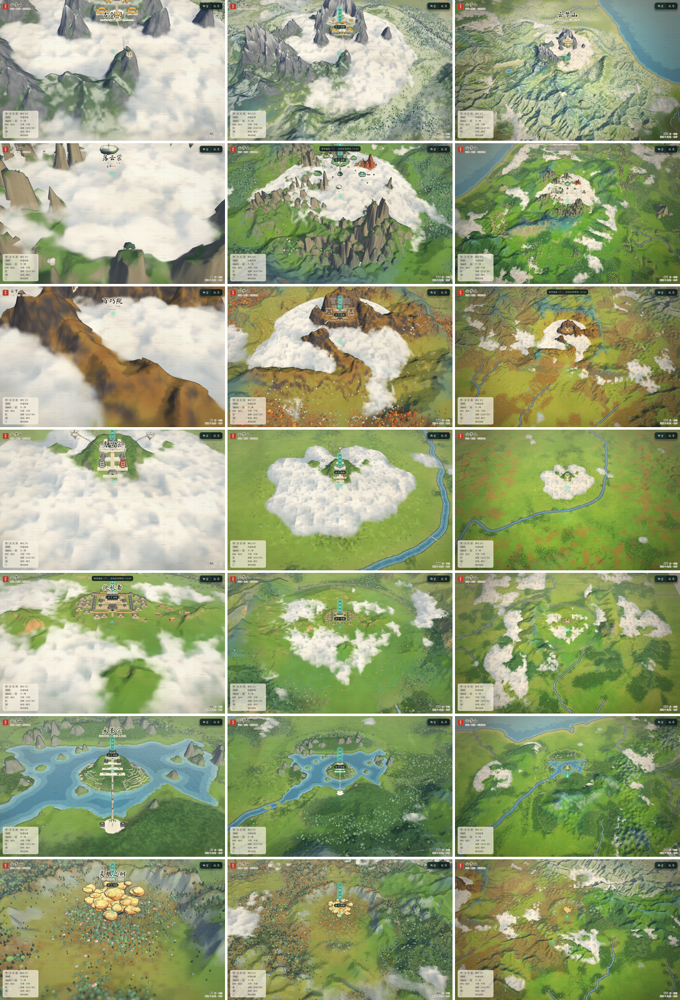

# 04 · The sects and the Spirit Eye Tree — a flight-optimised build plan

A plan for the local Godot + Blender work on the six sects and the 灵眼之树. Nothing here is built yet; it says what to
build, how, and why, for a game seen from a flying camera. It keeps **our lore** wherever it differs from the novel —
the choices and their flight reasons are in [terrain/03 §5](../terrain/03-world-plan.md#5-lore-decisions-our-lore-chosen-for-open-world-flight).

Companion docs: the per-sect **build sheets** with every structure, size and colour
([05 §2](../05-sects-architecture-cities.md#2-build-sheets)), the architecture kit and shaders (05 §1, §3), the Temple
kit workflow ([03 · upgrade roadmap §2](03-upgrade-roadmap.md#2-rebuilding-the-sects)), the terrain each sect stands on
([terrain/03](../terrain/03-world-plan.md)).

## 1. What the flight camera can see

The camera never yaws (it always looks north), pitches down with altitude, and has a 40° vertical field of view. At
1440 × 900:

| altitude 丈 (band) | pitch | slant distance to the target | **丈 per pixel** at the centre | view width |
|---|---|---|---|---|
| 950 (低空) | 38° | 1 540 | **1.25** | 1 800 丈 |
| 1 300 | 42° | 1 940 | 1.6 | 2 250 |
| 1 650 (中空) | 45° | 2 330 | **1.9** | 2 700 |
| 2 600 | 47° | 3 570 | 2.9 | 4 150 |
| 4 200 (labels fade) | 51° | 5 430 | 4.4 | 6 300 |
| 8 000 (高空) | 54° | 9 890 | **8.0** | 11 500 |

(From `director.gd`: `pitch_of`, `flight_pose`; CONFIG camera/zoom. 1 丈 ≈ 3.33 m.)

What that means:

- **Nothing smaller than ~1 丈 (3 m) is ever resolved** — not even at 低空. Railings, door studs, window lattices and
  roof-tile ridges are colour, not geometry. A 10-丈 hall front is 8 px wide at 低空 and 1 px at 高空.
- **Roofs are the building.** At 38–54° pitch a hall shows mostly roof: roof shape, colour and ridge ornaments are what
  identifies a sect from the air.
- **Only south faces and tops are seen.** No north face, no interior, ever (unless a landed/walk mode is added later —
  then add a separate close-up layer for that mode only).
- **At 高空 a sect is a 150–300-px patch.** It is recognised by its silhouette, palette and one beacon element.

### Design rules that follow

| # | rule | in practice |
|---|---|---|
| R1 | **Detail floor 1 丈** | no modelled detail under ~0.5 丈; texel density ≤ 2 texels/丈 at LOD0 (a 64-px trim covers 32 丈); vertex colour + a per-look atlas instead of unique textures; no normal maps except on roof tiles |
| R2 | **South-facing, top-weighted** | spend triangles on roofs, south façades, stairs and terraces; north walls flat, no interiors, back faces culled |
| R3 | **One beacon per sect** | one element ≥ 20 丈 across or tall, high contrast or glowing, readable at 8 丈/px (table in §4) |
| R4 | **Approach from the south (坐北朝南)** | the main axis runs N–S, the gate / 牌坊 at the south end, climbing north: the player flies north *into* the sect |
| R5 | **Layers by altitude** | 高空: silhouette + beacon + palette; 中空: building masses, axis, terraces; 低空: courtyards, stairs, glows, motion |
| R6 | **Above the cloud** | halls stand above the sect's cloud level (472–482 丈 in 云梦) or on islands; what is below the cloud is glimpsed through gaps |
| R7 | **Flight clearance** | every tall element (towers, spires, pillars, islands) is in `World.ground_clear` so the light rises over it (§2.6) |
| R8 | **Ink by layout, detail by texture** | facet ink (`bake_ink_layout.py`) on the big forms; textured kit pieces can rely on the screen-space ink edge (`post_ink`) instead |

## 2. Performance plan

### 2.1 Today

Every sect is one merged mesh plus one fine-ground mesh, loaded synchronously at boot by `props.gd`
(GLTFDocument), all at full detail all the time:

| file | triangles | | file | triangles |
|---|---|---|---|---|
| sect_gujian | 43.9 k | | sect_gujian_ground | 159 k |
| sect_luoyun | 53.7 k | | sect_luoyun_ground | 159 k |
| sect_baiqiao | 43.5 k | | sect_baiqiao_ground | 159 k |
| sect_luanming | 46.7 k | | sect_luanming_ground | 44.9 k |
| sect_nihang | 30.3 k | | sect_nihang_ground | 136 k |
| sect_shuiying | 42.5 k | | sect_shuiying_ground | 85.0 k |
| cities | 229 k | | props (landmarks) | 95.8 k |

≈ 1.3 M triangles, 1 primitive per file (no culling granularity, no LOD). `python3 tools/glb_budget.py` prints this table
for any set of GLBs.

### 2.2 Budgets per sect

| level | used at slant distance | detail | triangles | how |
|---|---|---|---|---|
| LOD0 | < 3 000 丈 (≤ 2.4 丈/px) | 1 丈 | ≤ 250 k | Temple-kit modules merged per building × material |
| LOD1 | 3 000–8 000 | 3–4 丈 | ≤ 60 k | decimated LOD0 (Blender Decimate / planar), merged per sect |
| LOD2 | 8 000–25 000 | 8–16 丈 | ≤ 8 k | hand-made silhouette proxy: plinths, roof prisms, the beacon |
| — | > 25 000 or the 舆图 | — | 0 | the map paints the sect's glyph |

Also: ≤ 150 draw calls per sect (MultiMesh for every repeated piece: lanterns, columns, balustrade posts, ridge beasts,
island trees), ≤ 4 materials (one atlas per look + vertex colour), ≤ 32 MB textures, ≤ 2 000 GPU particles.
`visibility_range_begin/end` on the LOD nodes with **no margins** (the review showed margins act as hysteresis when fading
is off).

### 2.3 Ground: displacement, not unique meshes

The six `*_ground.glb` are 742 k triangles of unique 13.3-丈 grids. Their heights are already in `World.t_patch_h` (one
texture-array layer per sect). Render the patches like the main terrain — shared grid meshes displaced in the vertex
shader, with the patch's own LODs — and keep real geometry only for what a heightfield cannot hold (pillar walls,
overhangs, the 蜂窝山 cliff, island undersides). Expected: −600 k triangles, −70 MB of GLB.

### 2.4 Streaming

Keep the LOD2 proxies of all sects resident (≈ 50 k triangles in total). Stream the LOD0/1 scenes with
`ResourceLoader.load_threaded_request` when the light comes within 15 000 丈, free them beyond 25 000 (hysteresis). Move
the sect scenes out of the `.gdignore`'d `data/world` into imported scenes (`godot/sects/<id>/`) so they load as `.scn`
with materials, instead of being parsed by GLTFDocument at boot.

### 2.5 Effects as shaders, not geometry

The 护山大阵 dome, spirit lights, light columns, pulse rings, molten falls (05 §3) are shaders on simple meshes; motion
(spinners, bobbing islands, flying swords, boats) is vertex-shader or MultiMesh-buffer animation, not per-node scripts.
No real lights: the world is unshaded — glow is emissive colour + the light-on-ground term.

### 2.6 Clearance

The flight already clears the terrain, 天柱山 and the terrain's rock instances (`World.ground_clear` + `rock_grid`). For
sects: put empties named `CLR_<name>` on tall elements in Blender (scale = radius, height); the exporter writes them to
`clearance.json` per sect; `World` adds them to the same grid. Floating islands are the one case a height field is wrong
for — the light should fly *under* 落云宗's islands too: give islands spheres the director pushes the light around
(lateral avoidance) instead of a height.

## 3. The Blender → Godot workflow for one sect

1. `blender --python tools/blender/import_world.py -- --sect luoyun --out luoyun.blend` — ground, the current halls as
   reference, trees, paths at 0.1 BU/丈 (= the Temple kit's metres).
2. If the land round the sect needs reshaping: `tools/blender/terrain_edit.py -- --site luoyun` → sculpt → `terrain_bake.py`
   ([terrain/04 §4](../terrain/04-tools.md#4-hand-edit-in-blender--terrain_editpy--terrain_bakepy)).
3. Build with the Temple modules (roadmap §2 lists them), keep the look palette (05 §1.2), one collection per building,
   names `<sect>_<building>` (05 §5.2).
4. LODs: duplicate → Decimate (Collapse 0.25, or Planar 5°) → LOD1; model LOD2 by hand (boxes + roof prisms + beacon).
   Name the nodes `*_LOD0`, `*_LOD1`, `*_LOD2`.
5. Ink: `tools/blender/bake_ink_layout.py` on LOD0/LOD1 big forms (plinths, walls, roofs); leave textured trim pieces
   unbaked (since the review fix, `props.gd` keeps their own materials).
6. Empties: `CLR_*` (clearance), `LAND_<id>` (the 落脚 point), `GATE` (the south approach), `FX_*` (where shaders and
   particles go).
7. Export `sect_<id>.glb`. In Godot, an `EditorScenePostImport` script assigns visibility ranges by the `_LODn` suffix,
   the facet material where the ink layout is present, and collects `CLR_` / `FX_` empties.
8. Check: `godot --path godot -- --terrain=res://data/terrain --tour=/tmp/t --tour-set=sects` (each sect from the south at
   低空, 中空 and 高空; add `--tour-only=luoyun` for one) and `python3 tools/glb_budget.py godot/sects/luoyun/*.glb`.
   Compare with the baseline below: every sect and the 灵眼之树 as they stand now, on the sculpted terrain, before any of
   this plan is built.

*`--tour-set=sects` today. Rows: 古剑门, 落云宗, 百巧院, 鸾鸣宗, 倪航斋, 水影宗, 灵眼之树; columns 低空 950, 中空 2600,
高空 8000 丈.*

## 4. The six sects

Lore as kept (our `places.json`); terrain from [terrain/03](../terrain/03-world-plan.md); full structure lists in
05 §2.1–2.6.

| sect | look | beacon at 高空 (R3) | what the approach shows (R4, R5) |
|---|---|---|---|
| 古剑门 | ice | three snow-capped granite peaks (太白 / 剑阁 / 东岭) with gold roofs stepping up the saddle; the 论剑台 sword-array glow | a south-facing saddle, a stone axis from the 牌坊 up to the 祖师堂, flying swords turning over the courts |
| 落云宗 | jade | a ring of six pillar clusters round a white cloud basin, jade islands floating on it | the pillar ring first, then the islands; at 低空 you fly between them |
| 百巧院 | gold | the 90-丈 five-storey stone tower and the bronze wheel, forge glow in the 蜂窝山 caves | the horseshoe's open mouth to the south, red maples, the water court |
| 鸾鸣宗 | phoenix | the twin towers (silver 龙楼 / red 凤楼) and three floating platforms with the 传送阵 beam | five terraces up a south slope above the 鸾水, a low cloud ring, gold 梧桐 |
| 倪航斋 | earth | a square rammed-earth fort on a flat 塬, the 五色土 altar as a coloured square seen from above | eight gullies biting into the tableland, cave dwellings in their walls |
| 水影宗 | water | the lake island with the 水影阁 and its reflection, the multi-arch bridge | karst towers round the lake, the island's terraces, boats |

### 4.1 古剑门 (主脉 · granite)

- **Terrain**: the granite core is the 祖山 of the range (terrain/03); palaeo-glacial cirques on 太白峰; the sect sits on
  the south-facing saddle with cloud in the valleys below (R6).
- **Build**: terraces as patch displacement (2.3); halls from the kit in gold-on-white with black lacquer; **snow on the
  roofs as a shader term** (look `ice`: whiten upward-facing roof normals), not geometry; the 剑阁 tower on the west peak
  and the pavilion on 东岭 as clearance (CLR_).
- **Motion**: flying swords as one MultiMesh (20–40 instances) rotated in the vertex shader; the 论剑台 ring a shader.
- **Budget**: LOD0 220 k (the axis halls carry most), LOD2: the three peaks are terrain, the proxy is the gold roof line.

### 4.2 落云宗 (东脉 · quartz sandstone) — the fly-through sect

- **Terrain**: the pillar forest of the 东脉 (rock instances) continues into the sect's own pillar clusters; the cloud
  basin at 472 丈.
- **Build**: the six named clusters as **hero pillars from the same rock kit** as the terrain's (one asset set: shared
  meshes, shared ink); islands: 3–4 instanced rock-underside variants (tapered rings, 04 §2) + kit tops; only the 藏经阁
  and 八角丹房 islands get arch bridges (lore).
- **Motion**: island bob in the vertex shader (one uniform per island), not scripts.
- **Flight**: islands get avoidance spheres (2.6) so the light can pass between and under them; pillar tops are CLR_.
- **Budget**: LOD0 250 k (islands + halls), the pillars count against the rock kit, not the sect.

### 4.3 百巧院 (西脉 · volcanic) — the open horseshoe

- **Terrain**: the caldera rim stands on 蜂窝山 and the two ridges and **stays open to the south**
  (`geology.json`: `"open": [180, 55]`); the valley floor under the cloud.
- **Build**: the 蜂窝山 tuff wall as **one hero cliff mesh** (baked AO, cave mouths as emissive decals with a forge
  flicker), the five-storey stone tower on its terrace in the valley, 天工殿 with the bronze wheel (a shader spin), the
  water court with its curved galleries; 镇火塔 under the cliff; watchtowers on both ridge tops.
- **Effects**: smoke from the furnace tower (≤ 300 particles), molten fall (05 §3.4).
- **Budget**: LOD0 200 k + the cliff 40 k.

### 4.4 鸾鸣宗 (the 鸾水 plain · red-bed basin)

- **Terrain**: the sect's green hill is its kept patch on the basin floor (green farmland with red-earth fields); the
  **red Danxia mesas** stand on the basin rim (four rim domes in the plan — one centred on the sect would meet its
  preserved ground and cut a square), so the grey-silver roofs and white jade read against red at 中空 / 高空 and the
  approach from the south crosses the south rim's jointed mesas; keep the low cloud ring round the hill foot.
- **Build**: five terraces on the south slope, the twin towers with their climbing galleries, 和鸣殿 on its arched 城台
  with the bronze 鸾 on the ridge, three floating formation platforms (05 §2.8) with the 传送阵 beam (05 §3.3).
- **Effects**: the pulse rings of the 联合之术 (05 §3.5) as the sect's motion.
- **Budget**: LOD0 180 k.

### 4.5 倪航斋 (eastern upland · loess)

- **Terrain**: the 塬 tableland and its eight gullies come from the loess operator; terraced fields on the gully walls
  as ground colour.
- **Build**: plain rammed-earth walls (very few triangles), corner towers, the gate tower, 乾元殿 and the scripture hall;
  the 五色土 altar is a top-down symbol — model it flat and saturated; 窑洞 as decal rows in the gully walls.
- **Budget**: LOD0 90 k — the cheapest sect; spend the saving on wheat/millet ground cover on the 塬.

### 4.6 水影宗 (east coast · karst lake)

- **Terrain**: karst towers round the lake (rock instances), the sect's lake and island kept.
- **Build**: the 水影阁 on its arched white 城台, terraced side halls with paired lotus pools, the covered bridge west, the
  multi-arch bridge with pavilions to the south pier.
- **Reflection**: do it the demo's way — draw the sect's meshes a second time, mirrored at the water level, with a
  ripple-distorting shader (the demo's `buildMirrors`, L5842–5853) — no extra render pass. Boats as a MultiMesh on a path.
- **Budget**: LOD0 180 k (+ the mirrored draw of LOD1 only).

## 5. Cross-sect savings

- **One rock kit** for the terrain's towers / pillars / stacks and the sects' hero rocks (`rock_kit.gd` today; Blender
  SDF rocks later — [terrain/05 §5](../terrain/05-other-projects.md#5-what-to-do-next-in-order)).
- **One kit atlas per look** (six looks) — every sect's materials index one 2k atlas + vertex colour.
- **Shared MultiMeshes** for the repeated small props of all sects (lanterns, stone beasts, banners) — one per kind,
  instances in world space.
- **Shared effect shaders** (dome, glows, columns, rings) with per-sect uniforms.

## 6. Order of work

1. Tooling (½ day): `--tour-set=sects`, `tools/glb_budget.py` (both in the repo now), the `CLR_` clearance export.
2. **落云宗** (the hardest and the signature: pillars + islands + fly-through) — proves the kit, LODs and avoidance.
3. **灵眼之树** (§7) — one hero site, proves the cliff patch and the glow beacon.
4. **古剑门**, **百巧院** — the other two 云梦 sects, sharing the hall kit.
5. **鸾鸣宗**, **水影宗**, **倪航斋** — the eastern sects.
6. Ground displacement for the patches (2.3) and streaming (2.4) once there are several heavy sects.

## 7. 灵眼之树 (the Spirit Eye Tree)

**Our lore, kept**: one of the three divine trees, in the forbidden ground deep in 云梦山 between the three sects; it
stands in a valley ringed by cliffs, its crown glowing pale cyan-white, streams falling from the valley in tiers; about
every two hundred years a nectar seeps from its roots (明清灵水); the 试剑大会 decides who may wash their eyes; spies
in league with the 魔道 come for it. Site: the `lingyan` landmark (−4 200, 4 567), in the 笋石林 · 灵眼 limestone belt.

### 7.1 Flight design

- **Found by flying**: a beacon visible at 高空 — the crown's glow (≥ 120 丈 across = 15 px at 8 丈/px) and a white
  ring of mist (the 禁地 formation) round the valley rim. Within ~1 500 丈 of the light the mist ring parts, the way the
  cloud sea opens round the player (`cloud_sea.gdshader`'s `part` term).
- **Entered from the south**: the valley drains south through a gorge with the tiered falls; the player flies north up
  the gorge and the north-facing camera looks straight into the bowl — the falls, the cliffs, the crown.
- **Sizes**: basin ≈ 900 丈 across (one screen at 低空), cliffs 150–250 丈 above the floor, trunk ≈ 120 丈, crown
  120–180 丈, three fall steps of 30–60 丈.
- **Canon, as a nod**: a cave mouth at the foot of the north cliff (a stalactite cave); the tree's pale-green "stone
  pillar" root goes down into it — the nectar seeps there. The interior is optional (a hero cave scene or godot_voxel).

### 7.2 Terrain

The limestone collapse basin is kept by the re-sculpt (the landmark is preserved). Make the cliff ring with
`terrain_edit.py -- --region -5400,3400,-3000,5800` (sculpt vertical walls, ledges, the south gorge and fall steps) →
`terrain_bake.py`. Vertical 200-丈 walls are only ~5 cells on the 40-丈 grid, so give the site **its own fine patch**
like the sects: export `lingyan_ground.glb` + a 13.3-丈 height raw, register it in `meta.patches` (the terrain then
discards beneath it, exactly as for the sects), and model the overhangs and the cave mouth as a cliff mesh on top.

### 7.3 Build (Blender)

- **Tree**: trunk and branch skeleton from Geometry Nodes (or the Sapling add-on), canopy as **faceted blobs** in the
  tree kit's style (they take the facet ink), plus a translucent glow shell; bark and canopy in the jade-white palette.
- **Falls**: ribbon meshes on the three steps with the flow shader (05 §3.4), mist particles at each foot.
- **Cliffs**: one ring mesh, limestone karren streaks in vertex colour, 斧劈 / 荷叶 皴 by the ink shader.
- **LODs**: tree LOD0 40 k (< 3 000 丈), LOD1 8 k, LOD2 an impostor card + the glow sprite (always on — it is the beacon).
- **Budget**: the whole site ≤ 150 k triangles, 3 materials (bark, canopy, glow), ≤ 1 500 particles (motes + mist).

### 7.4 Godot

- `spirit_tree.tscn` placed at the `lingyan` mark: the tree LODs, a slow emissive pulse in the canopy shader, spirit
  motes (`GPUParticles3D`), the mist ring (a ring mesh with a cloud-sea-style shader that opens by distance to the light),
  the falls.
- The hotspot (落脚 → card) is already wired; add the crown top as `CLR_` clearance.
- Optional: the 试剑大会 arena as a terrace on the south rim, lit during the event.
- Check: `--tour-set=sects` includes 灵眼之树 at the three altitudes.
