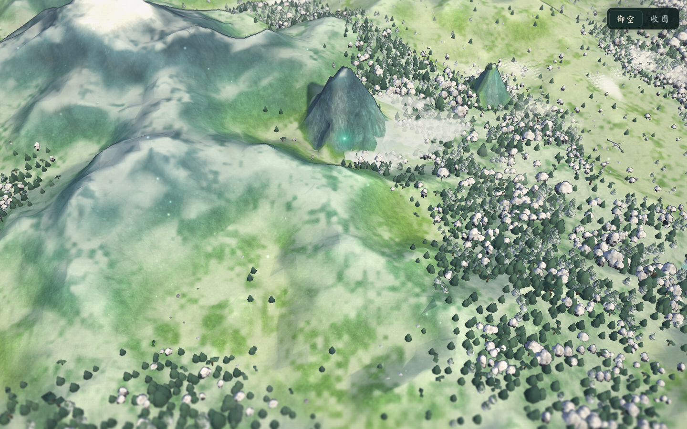
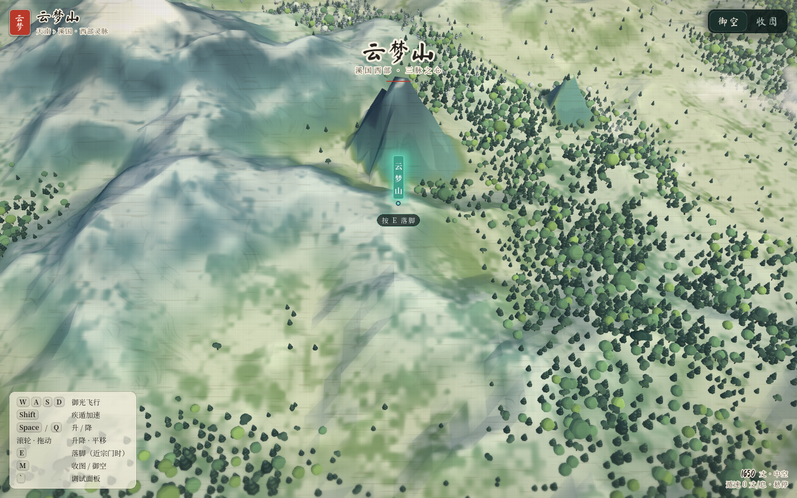
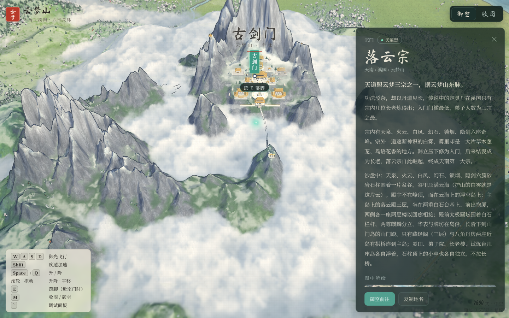
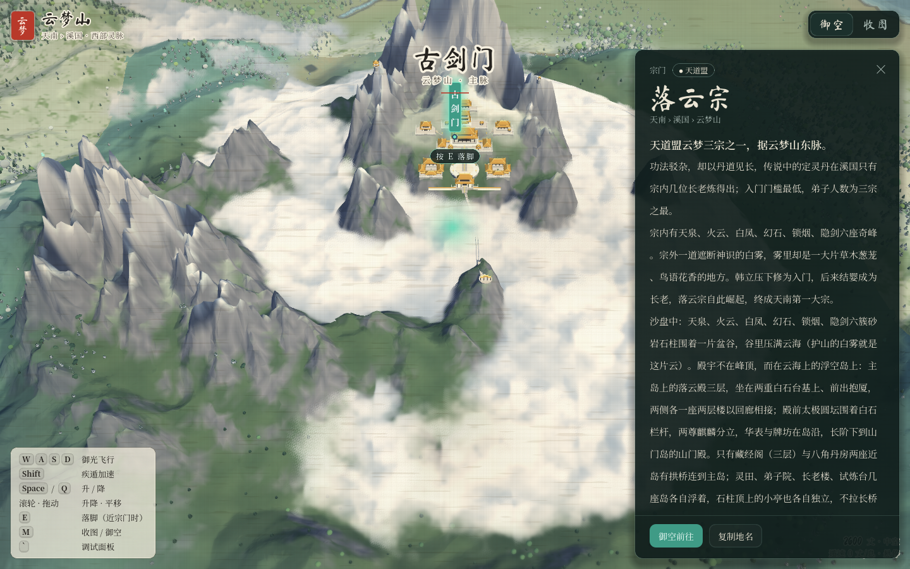
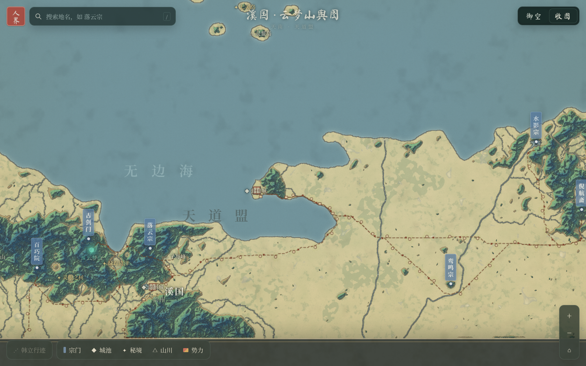
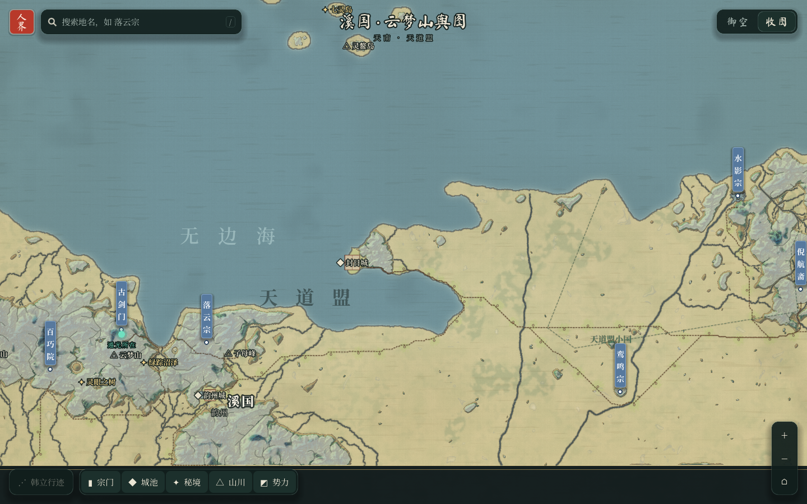

# Godot port — guide

`godot/` is a working Godot 4 project that rebuilds the demo's flying map: the same world (exported from the demo, not
re-invented), the same flight and camera maths, the fly ⇄ 舆图 transition, the painted map, and **the full UI**. It is
meant as the base you extend with Blender assets — see [01 pipeline & Blender](01-pipeline-and-blender.md),
[02 UI recreation](02-ui-recreation.md) and [03 upgrade roadmap](03-upgrade-roadmap.md).

| | |
|---|---|
| Engine | Godot **4.4+** (developed and verified on **4.7.1**). Forward+ by default; Mobile and Compatibility work too (shaders handle both colour paths) |
| Size | ~180 MB of exported world data (`godot/data/world`), fonts subset to ~10 MB |
| Verified | boots, intro → flight → hotspot/E → card → 舆图 (zoom, legend, trail, search) → flight → debug panel, scripted under Xvfb (see screenshots below) |

## Run it

1. Open `godot/project.godot` in Godot 4.4+ (first import takes a minute: fonts and card images).
2. Press F5. The world data in `godot/data/world` is read at runtime (the folder has a `.gdignore`, so the editor does
   not try to import 180 MB of rasters and meshes).
3. Command-line flags (after `--`): `--skip-intro`, `--no-autoquality`, `--shots=<dir>` (scripted walkthrough that saves
   PNGs and quits — the same states as `docs/screenshots`), `--dump-sun` (writes the sun bake to `user://t_sun.png`).

```bash
godot --path godot -- --skip-intro
godot --path godot --rendering-driver opengl3 -- --shots=/tmp/shots     # headless-ish check, e.g. under xvfb-run
```

To regenerate the world data after changing the demo: `cd tools/export-world && npm install && npm run export`.
To regenerate the UI scenes/theme after changing `tools/build_scenes.gd`: `godot --headless --path godot res://tools/build_scenes.tscn`.

## Controls (same as the demo)

WASD / arrows fly (north-up, the camera never turns) · Shift 疾遁 · Space / Q or wheel climb / descend · drag to grab the
ground (fling on release) · E 落脚 near a sect · M 收图 / 御空 · `/` search on the map · Esc close · H hint · ` debug panel.
Touch screens get the stick and the 疾 button.

## Project layout

```
godot/
├─ project.godot              autoloads, input map, shader globals (map_k, sun_dir, toon, haze…, t_height, t_water…)
├─ data/world/                the exported world (tools/export-world) — see 01-pipeline-and-blender.md
├─ fonts/                     Ma Shan Zheng + Noto Serif SC 400/600/700/900 (subset, OFL)
├─ scenes/main.tscn           the main scene (generated by tools/build_scenes.gd, editable)
├─ ui/                        hud, hotspots, hotspot_tag, map_chrome, info_card, intro, mode_switch, debug_panel, toast,
│  │                          loading, touch (.tscn, generated, editable) · theme/ink_theme.tres · cards/*.jpg
├─ scripts/
│  ├─ autoload/cfg.gd         the demo's CONFIG (read from meta.json), dotted get/set, change signal
│  ├─ autoload/world.gd       loads the export; h_at / ground_clear / water_at samplers; global textures
│  ├─ autoload/game.gd        modes, map_k (= uMap), selection, legend/trail state, signals
│  ├─ director.gd             camera + modes: intro, flight, fly⇄map transition, 舆图 pan/zoom, input
│  ├─ main.gd                 boot order, per-frame altitude-driven updates, post params, auto quality, config routing
│  ├─ shots.gd                scripted walkthrough (--shots)
│  ├─ world/terrain.gd        chunks of shared grid meshes, 4 LODs by visibility range, skirts
│  ├─ world/props.gd          sect / city / landmark GLBs via GLTFDocument + facet ink material
│  ├─ world/trees.gd          1.4 M trees → MultiMesh per (2600-丈 chunk × kind), parsed on a thread, thinned by altitude
│  ├─ world/tree_kit.gd       the 9 low-poly tree kinds (stand-ins for Blender / asset-library trees)
│  ├─ world/cloud_sea.gd      the cloud sea's top surface where the plan has cloud
│  ├─ world/sun_bake.gd       t_sun: shadow / cloud-sea shadow / sky openness, baked once on the GPU
│  ├─ world/map_plane.gd      the painted 舆图 plane + map_overlay.gd (roads, villages, cities painted once)
│  ├─ world/light_trail.gd    遁光: halo / inner / head glow quads and the tapered trail
│  └─ ui/*.gd                 one script per UI scene (+ ui_util.gd: tokens, fonts, helpers)
├─ shaders/
│  ├─ land_common.gdshaderinc noise, flat tones, haze, light-on-ground, intro reveal, colour output
│  ├─ terrain / facet / water / tree / cloud_sea / map2d / light_glow / light_trail .gdshader
│  ├─ sun_bake.gdshader       (canvas) the bake
│  └─ post_ink.gdshader, post_screen.gdshader   depth ink edges; tilt-shift + grade + silk + vignette
└─ tools/build_scenes.gd(.tscn) builds the theme and every scene from code
```

## How the demo maps onto the port

| demo (index.html) | port | status |
|---|---|---|
| CONFIG (§01) | `Cfg` autoload reading `meta.json` | ✅ same values |
| GEO / layout / heightfield / water / zoning (§00–03d) | **exported**, `World` autoload | ✅ identical data (not regenerated) |
| land tiles + LOD + skirts (04) | `terrain.gd` + `terrain.gdshader` | ✅ shared meshes displaced on GPU; mountain colour ramp read back from the demo |
| plains / biome ground (04) | `terrain.gdshader` (`biome_ground`) | ◐ meadow/sand/marsh/season/steppe; no flower dabs, terraces, ground detail tiles yet |
| sun bake (04) | `sun_bake.gd` | ✅ same march |
| sect fine patches (04) | `sect_*_ground.glb` + facet shader | ✅ (exported meshes) |
| earth banks 土崖 (04) | — | ✗ (the ground dives under the water instead) |
| water (05) | `water.gdshader` | ✅ steps, Gerstner shading, Fresnel, glints, shore ink ripples |
| mirror water, upland lakes (05b/05c) | — | ✗ |
| buildings, cities, landmarks (06, 06b–06e) | `props.gd` + exported GLBs | ✅ geometry & ink; ✗ animated parts, formation domes, lights |
| trees (06) | `trees.gd` / `tree_kit.gd` / `tree.gdshader` | ✅ positions/kinds/colours/wind/thinning; stand-in meshes |
| roads / streams / villages 3D (06) | — | ◐ on the 舆图 only (overlay); 3D ribbons ✗ |
| card clouds, god rays, cirrus, cloud falls (07) | — | ✗ |
| cloud sea (07c) | `cloud_sea.gd/.gdshader` | ✅ ray-marched slab, sect lift, opening round the player |
| 遁光 (08) | `light_trail.gd` | ◐ glow + trail; no speed lines, ground ink shadow is in the ground shaders |
| cultivator figure (08b) | — | ✗ (off in the demo too) |
| post (09) | `post_ink` + `post_screen` | ◐ ink edge, tilt-shift (mip blur), grade, silk, vignette |
| 舆图 painting (10) | `map2d.gdshader` + `map_overlay.gd` | ✅ |
| cranes, flyers, life, deer, motes (11) | — | ✗ |
| flight / camera / intro / transition / input (12) | `director.gd` | ✅ same formulas |
| UI (HTML/CSS) | `ui/*.tscn` + `scripts/ui/*.gd` + theme | ✅ every element (see 02) |
| debug panel (13) | `debug_panel.gd` | ✅ main groups; no pick mode |
| auto quality (14) | `main.gd` | ✅ via `scaling_3d_scale` |

The ✗ rows are where the asset-driven upgrade goes — [03 upgrade roadmap](03-upgrade-roadmap.md) has a plan for each.

## Godot techniques used (and why)

- **One flatten value for the whole world.** `map_k` is a *global shader uniform*; every world shader does
  `wp.y *= 1.0 - map_k` in `vertex()` and fades with it, exactly like the demo's `uMap`.
- **Shading by hand.** All world shaders are `unshaded` and compute the demo's three flat tones, AO, ink and haze from
  global uniforms (`sun_dir`, `toon`, `t_sun` …). No DirectionalLight, no engine shadows — they cannot cover a
  130 000-丈 view the way the bake does.
- **Colour output on every renderer.** The demo does its maths on display-space values. Forward+/Mobile convert
  linear→sRGB at the output but Compatibility does not, so each shader ends with
  `ALBEDO = OUTPUT_IS_SRGB ? col : to_linear(col);` — same picture on all three.
- **Terrain without building meshes.** Four grid meshes (64/32/16/8 segments + skirt) are shared by 1 664 chunk
  instances; the vertex shader reads the half-float height texture. Visibility ranges (0–5200–10500–26000–∞) pick the LOD.
  The sects' fine ground comes from their exported patch GLBs; the terrain shader discards inside the patch rects.
- **Data outside the import system.** `data/world/.gdignore` + `Image.load_from_file` / `FileAccess` / `GLTFDocument`
  at runtime: no 180 MB import step, and the GLB facets are not welded by the importer (welding would break the
  barycentric ink). For an exported game, add `data/world/*` to the export's non-resource include filter (or drop the
  `.gdignore` and import the GLBs with "Generate LODs" off).
- **Heights as raw half floats.** Godot's PNG loader strips 16-bit PNGs to 8 bits, so heights are read from
  `height_f16.bin` (IEEE half → `Image.FORMAT_RH`). The 16-bit PNGs are there for Blender / Terrain3D.
- **1.4 M trees in seconds.** Parsing and bucketing run on a `Thread`; MultiMesh buffers are written as one
  `PackedFloat32Array` (transform + custom data); shuffled per bucket so `visible_instance_count` thins evenly.
- **UI as generated-but-editable scenes.** `tools/build_scenes.gd` builds the theme (StyleBoxFlat variations for every
  CSS class) and all scenes in code and saves them; open them in the editor and keep editing there.

## Screenshots (demo vs port)

| | demo (Three.js) | Godot port |
|---|---|---|
| flight |  |  |
| card at 古剑门 |  |  |
| 舆图 |  |  |

(The port's shots are rendered with Mesa llvmpipe through the Compatibility renderer under Xvfb.)
