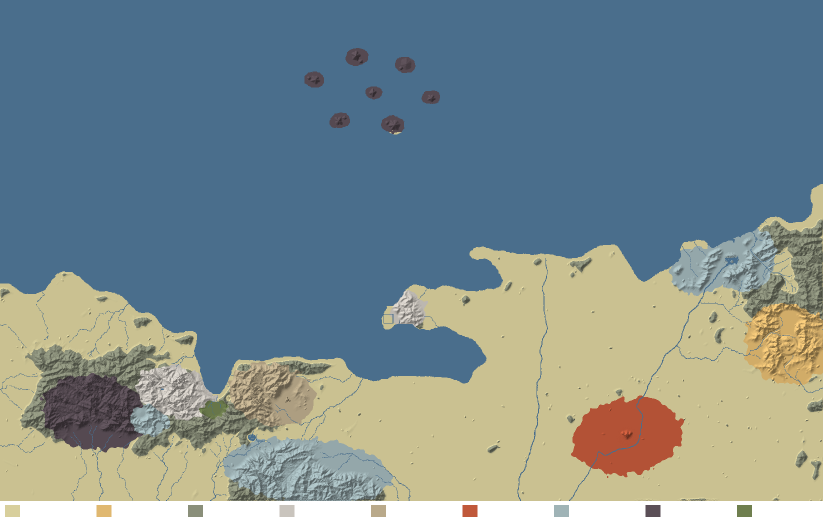

# 03 · The world plan: 溪国, 云梦山 and the 天道盟 coast, rebuilt on geology and canon

This is the geological plan the tools ship with (`tools/terrain/make_plan.py` → `tools/terrain/plan/`). It keeps the
demo's layout — the 舆图's coast, rivers, sect sites, cities and landmarks — and decides what each piece of land is made
of and why, so that the landforms follow from rock and structure rather than from per-place stamps. Canon facts come from
the dossier [research/r2_fanren_geography.md](research/r2_fanren_geography.md) (source kinds: **novel** text, the
**handbook** 《凡人必备手册》, **wiki**, **fan**, **donghua**); geology from [02](02-landforms.md) and
[research/r3](research/r3_landform_geology.md).

*The default plan over the exported relief. Swatches, left to right: alluvium · loess · metamorphic (fold belts) ·
granite · quartz sandstone · red beds · limestone · volcanic · lacustrine. The region outlines are domain-warped
ellipses — a starting point to repaint.*

## 1. A geological history that explains the map

A plausible history is what makes the parts agree with each other. Ours, oldest first:

1. **A limestone sea.** A long-lived carbonate platform lays down thick limestone over the whole region — the rock of
   the 南山 range below 韵州, the 笋石林 / 灵眼 belt, the east coast and 水影宗.
2. **Folding and a granite core.** Compression folds the platform and the older shales and sandstones into the
   ENE-striking **云梦 fold belt** (the demo's `trend` 15°); a **granite batholith** rises into its core and cools there
   (the Huangshan story, [02 §3.1](02-landforms.md#31-granite--花岗岩-古剑门s-主脉-the-封日城-headland)). East of the core
   the thick **quartz sandstones** of the 东脉 stay nearly flat-lying.
3. **Red basins.** In the quiet that follows, rivers fill an inland basin on the eastern plain with **red sand and
   gravel** — the 鸾鸣 red beds.
4. **Rifting and fire.** Extension breaks the range: two faults drop the **绿踪 graben** between the 主脉 and the 东脉,
   a range-front fault raises 云梦 above the northern coast, and on the 西脉 a volcano erupts and collapses into a
   **caldera** — welded tuff walls, hydrothermal ores and the 地肺火 that 百巧院 forges on.
5. **Uplift and erosion.** The whole country rises; rivers cut down to the sea, the granite and quartz sandstone stand up
   as spires and pillars, the limestone dissolves into cone clusters above the water table and towers at it.
6. **Ice and wind.** In the cold ages glaciers cap 云梦's summits (cirques, U-troughs, hanging valleys with falls); dust
   blown from the north drapes the eastern upland in **loess** — 倪航斋's 黄土.
7. **The sea, recently.** Off the coast a young volcanic field breaks the surface — the islands that, in the novel,
   "surfaced after the vortex's qi purified the sea" (七灵岛, handbook). 大漩涡 sits over a collapsed submarine caldera
   (our reading; canon: the eye of a broken sealing array, handbook).

## 2. Region by region

| region | rock (plan colour) | canon (source kind) | why this rock | what the land does now |
|---|---|---|---|---|
| **云梦山 主脉** — 古剑门, 云梦山主峰, 飞练崖, 迎仙松 | granite core in a metamorphic fold belt | 古剑门 on the 主脉, sword cultivation (handbook); no landscape found | the hardest rock stands highest and breaks into sword-like spires and sheer walls | sharpened crests, joint slots, domes, granite spires; the 祖山 of every 云梦 sect's 龙脉 |
| **云梦山 西脉** — 百巧院, 古修洞府, 天柱山 | volcanic | 百巧院 on the 西脉, artifact refining (handbook); the novel's plaza is "四面环山" with a 百丈 tower against a cliff riddled with holes and a 地肺火池 inside (ch. 863 via search extract) — **we keep our lore's horseshoe open to the south** (§5) | an old caldera, breached to the south: carvable welded-tuff walls for cave dwellings, earth-fire for the forges | an eroded caldera rim round 百巧院 that stays out of the southern sector (`"open": [180, 55]`) and is breached by its streams, cinder cones; 天柱山 kept as the demo's monolith (canon: "孤零零一座陡峭山峰", handbook → an inselberg / volcanic neck) |
| **笋石林 · 灵眼之树** | limestone | the novel puts 灵眼之树 in a vast stalactite cavern ("此石窟長寬數百丈，高二三十丈", ch. 628) — **we keep our lore's open, cliff-ringed valley** (§5); 笋石林 is a demo route stop | a collapse basin in limestone explains the cliff ring and the tiered falls; the canon's cavern survives as a cave under the cliff | fengcong cones riding on the massif; the round 灵眼 basin kept (a demo landmark) as the open bowl |
| **云梦山 东脉** — 落云宗, 子母峰, 听云亭 | quartz sandstone | 落云宗 on the 东脉, six 奇峰 天泉/火云/白凤/幻石/锁烟/隐剑 (handbook), a mist-filled protective formation (novel ch. 1173) | thick flat beds + two joint sets = the 张家界 peak forest; 奇峰 rising out of mist | joint gorges, plateau remnants and ~1 850 pillar instances along the valleys; the sect's own patch (with 火云峰's red Danxia bands) is kept |
| **绿踪沼泽** | lacustrine, in a graben | on the 落云宗–古剑门 border, remote, miasma all year (handbook; ch. 604 title) | a fault-bounded basin between two ranges drains badly → swamp | flattened basin floor, reed islets; its two faults end with the basin, so the ridge south of it (落云宗's 过峡) survives |
| **南山** (south of 韵州城) | limestone | — (韵州 / 韵州城 are unverified / the demo's) | a karst range beside a city is the Guilin–Yangshuo picture | cockpit karst cones in clusters, karst valleys, towers on the 韵州 plain |
| **封日城 headland** (闵州) | granite | 闵州 the largest 州, on the 无边海; 封日城 its capital (handbook) | a granite headland makes a defensible harbour | cliffs and sea stacks; the city core is kept |
| **east coast hills, 水影宗** | limestone | 水影宗 unverified | drowned karst: towers at sea level, stacks offshore (下龙湾) | karst towers and cones, the sect's karst lake kept |
| **倪航斋** | loess | probably canon (handbook mention); location and terrain are the demo's | loess for an earth-arts (乾土功) sect | 塬 tablelands and dense gullies |
| **鸾鸣宗** | red beds (Danxia) | one of the 天道盟 three great sects (handbook); location the demo's | 丹霞 — cinnabar walls and rosy cloud for a phoenix sect | uplifted red hills stepped into mesas with 一线天 slots |
| **七灵岛, 灵鳌 / 灵龟 / 灵凤** | volcanic | seven islands that surfaced (handbook); 灵龟 held by 太真门, 灵凤 by 合欢宗, 灵鳌 given to 韩立 (handbook) | young volcanic islands (Surtsey-type) | stratocones with radial gullies, 灵龟 a caldera ring |
| **the plains** (溪国 lowland, 天道盟 east) | alluvium | 溪国: northernmost state of 天南, 7 州 (handbook) | river plains | alluvial fans at the range fronts, river terraces, a low swell |

## 3. Structures in `plan/geology.json`

| kind | name | what it does |
|---|---|---|
| fold belt | 云梦褶皱带 (strike 15°, dip 35°, beds 300 丈) | strike ridges and trellis valleys in the bedded rocks of 云梦 |
| fold belt | 东山褶皱带 (strike 30°) | the eastern range's grain |
| fault | 绿踪西缘 / 东缘断层 | the graben (west side up W, east side up E), only as long as the swamp |
| fault | 飞练断崖 | the south-facing scarp the 飞练崖 falls drop from (demo `layout.falls`) |
| fault | 云梦北缘断层 | the range front above the northern coast |
| fault | 东山山前断层 | the eastern range front |
| volcano | 百巧院 古破火山口 (caldera, r 3 800) · 灵鳌 · 灵凤 · 七灵主岛 (strato) · 灵龟 (caldera) | |
| uplift ridge | **云梦东脉 龙脉** | 落云宗's dragon vein: from the 祖山 above 古剑门 down the 主脉, round the south of 绿踪, up to the 东脉 |
| uplift | 鸾鸣丹霞丘 西 / 东 / 南 / 西南 | the red hills on the rim of the 鸾鸣 basin (to ~130 丈: Danxia relief 30–90 丈, ×2 for the walls); domes on the rim, not one on the sect, so the sect's preserved hill stands on a flat red floor instead of a square cut into an uplift |
| glacier | ELA 650 丈 | palaeo-glaciation of 云梦's summits (cirques, short troughs) |

## 4. Spirit veins, spirit eyes, mist: the canon's vocabulary on geology

- **灵脉 = deep structure.** The canon shares 云梦山's 圣脉 out by sub-range (主脉 / 东脉 / 西脉, novel ch. 599) — which
  is exactly how a geologist would split it: the granite core, the quartz-sandstone east, the volcanic west. In the
  tools a 灵脉 is a **ridge line** (`structures.uplift` with `pts`) or a **fault** (`structures.faults`).
- **灵眼 = where the deep comes up.** Springs where faults cross; karst resurgences; the 灵眼之树 in a cavern fed by
  the range's veins (novel ch. 628; wiki). 地脉灵眼 (a demo route stop) sits on the eastern graben fault — a natural home.
- **Mist = formation.** Protected places in the canon are hidden in mist formations (落云宗's restriction "full of mist",
  novel ch. 1173; the mist-veiled path to the 灵眼之树). Physically that mist is the valley **inversion fog** of
  [02 §4](02-landforms.md#4-the-cloud-sea-physically) — the cloud sea fills each basin to its spill level; a sect's
  formation is the basin it sits in.
- **Sites follow 形势.** Sects sit 背山面水 in enclosed bowls on a dragon vein; `fengshui.py` checks it
  ([04 §5](04-tools.md#5-read-the-land-fengshuipy)). Current scores (exported land → re-sculpted): 古剑门 0.62 → 0.64,
  落云宗 0.45 → 0.46 (after its 龙脉 fix), 百巧院 0.45 → 0.45, 鸾鸣宗 0.52 → 0.52, 倪航斋 0.34 → 0.32, 水影宗 0.68 → 0.67.
  The perched mountain sects score 0 on 明堂 (no level ground in front — they look down on a cloud sea instead), which is
  a 仙侠 choice, not an error.

## 5. Lore decisions: our lore, chosen for open-world flight

Where our lore and the novel disagree (dossier §5.2), **our lore stands** — each choice was made for a game seen from a
flying, always-north-facing camera between 950 and 8 000 丈, and the terrain is built to it. The canon stays in the docs
as background and, where it costs nothing, as a nod.

| # | topic | **kept (our lore)** | canon (for reference) | why it is better for flight | terrain / build consequence |
|---|---|---|---|---|---|
| C1 | **灵眼之树** | an open valley ringed by cliffs, the crown glowing pale cyan-white, streams falling in tiers | inside a giant stalactite cavern; an arm-thick pale-green "stone pillar" under a gold light dome (ch. 628–629) | a cave is invisible from the air; an open bowl with a glowing crown is a **beacon** you find by flying, and the tiered falls give the approach motion | limestone collapse basin, kept open to the sky; the cavern becomes a cave mouth under the cliff (optional interior) — [Spirit Eye Tree plan](../godot/04-sects-and-spirit-tree-plan.md#7-灵眼之树-the-spirit-eye-tree) |
| C2 | **落云宗** | six sandstone pillar clusters round a cloud-filled basin, halls on floating islands, no main peak | six separate peaks; a main peak with a town on its lower half and purple fog above (wiki) | islands over a cloud sea are the one sect you **fly through** rather than over; the pillar ring frames it from every altitude | the pillar forest of the 东脉; islands are meshes over the basin's cloud level (472 丈) |
| C3 | **province** | 韵州 / 韵州城 | 湳州 (wiki) | names only; 韵州城 is a landmark city on the approach plain | none |
| C4 | **子母峰** | one main peak ringed by three low ones | shape unknown; the donghua's 天泉峰 + two lesser peaks | a ring of four peaks reads as a **formation site** (最宜布置法阵禁制) from above | a mother pillar and three children (the demo landmark), kept |
| C5 | **百巧院** | a horseshoe open to the south, a 九十丈 five-storey stone tower in the valley | mountains on all four sides; a ~百丈 tower on a platform against the cliff | the player flies north into the open mouth and the camera looks **into** the bowl — tower, forge glow and cliff caves all face it | the caldera rim is breached to the south (`open: [180, 55]`) |
| C6 | 古剑门's 太白峰 | the highest granite peak, snow, the 金剑 frozen in ice after the 百巧院 duel | sword art 太白剑诀 only | a snow-capped highest peak is the range's landmark from the north coast and from altitude | the granite core is the 祖山; palaeo-glacial cirques on its summit |
| C7 | the spies | 勾结魔道 | 正魔两道 jointly (fan) | lore text only | none |
| C8 | 灵鳌岛; the islands south of 大漩涡 | 灵鳌岛; south of the vortex | 灵鳖岛 (Baike); "near 溪国" | names; the vortex as a northern horizon landmark over the islands | none |
| C9 | 落云宗's end | 终成天南第一大宗 | two versions of the ending | lore text only | none |
| C10 | 天柱山 | "传说高达万余丈", a cloud belt round its waist | 万余丈 (hyperbole) | stays a legend; the 1 300-丈 monolith with a cloud belt is the west's direction marker | the demo's pillar mesh, cleared by the flight (`ground_clear`) |
| C11 | 封日城 | in the handbook only | handbook | the north coast's harbour city on the headland | none |

## 6. Next iterations, per place (for Godot + Blender)

The sects and the 灵眼之树 have a full flight-optimised build plan in
[godot/04 · sects and the Spirit Eye Tree](../godot/04-sects-and-spirit-tree-plan.md); the notes below are the terrain side.

- **古剑门** — a granite spire kit (Blender: jointed prisms with exfoliation sheets, 斧劈 facets); the halls on benches
  between spires; snow only above the palaeo-ELA cirques.
- **落云宗** — keep the pillar forest; model 6 hero pillar clusters for the named peaks; the floating islands over the
  basin's cloud sea; the formation mist as basin fog.
- **百巧院** — the 蜂窝山 tuff wall (the caldera's back) as a hero cliff mesh with cave dwellings and forge glow; the
  five-storey stone tower on the valley's stone terrace, the horseshoe open to the south.
- **灵眼之树** — the open cliff-ringed valley with the glowing crown and tiered falls; the canon's cavern as an optional
  cave under the cliff. Full plan: [godot/04](../godot/04-sects-and-spirit-tree-plan.md#7-灵眼之树-the-spirit-eye-tree).
- **笋石林** — a stone-forest operator (blades 6–12 丈 [r3 S17]) around the demo's landmark.
- **鸾鸣宗** — Danxia hero walls with alcoves (overhangs need meshes), a waterfall off a caprock edge.
- **七灵岛** — black-sand beaches, young lava fields, steam; 大漩涡 as a maelstrom over the caldera.
- **Everywhere** — trees by rock and height (pines on granite crags, broadleaf in karst, bamboo in the red basin, willow
  on the plain); waterfalls where hanging valleys and caprock edges meet the drainage (the `glacier` and `redness` layers
  mark candidates).
