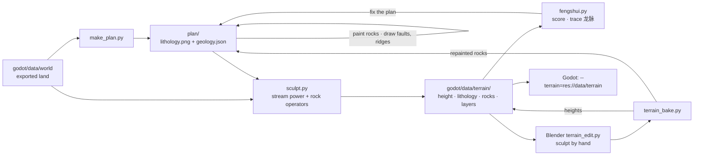
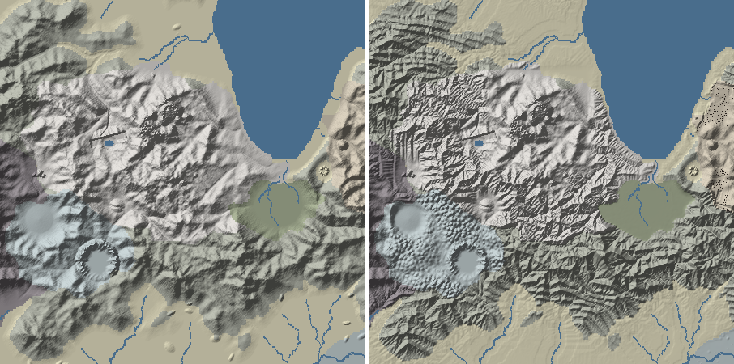
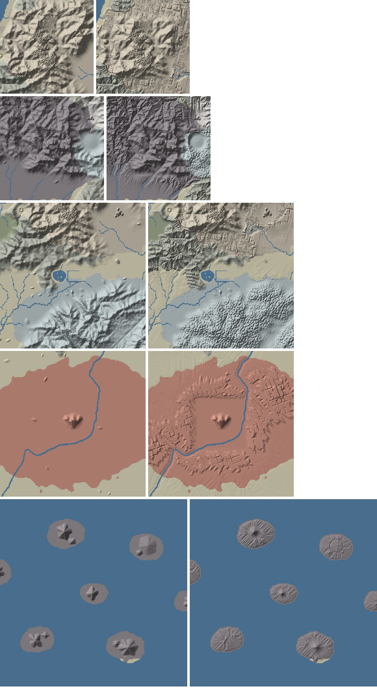
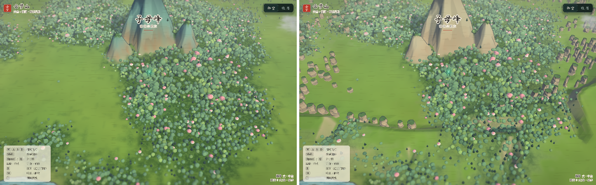
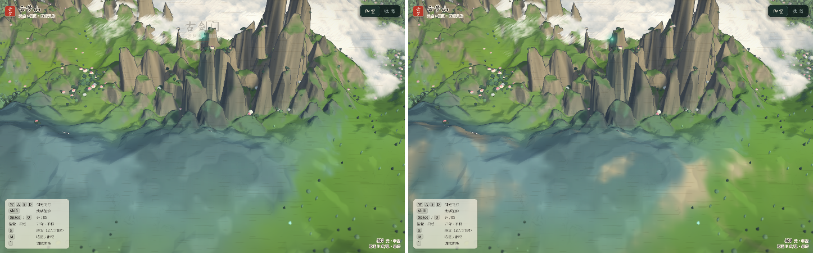
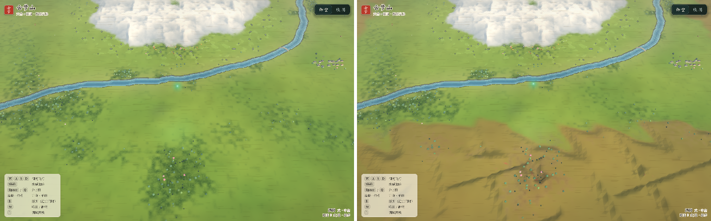
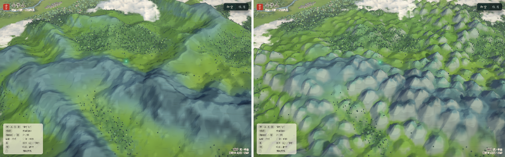
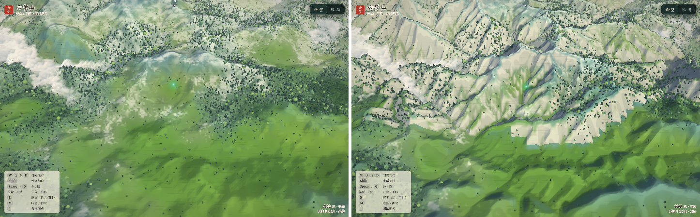
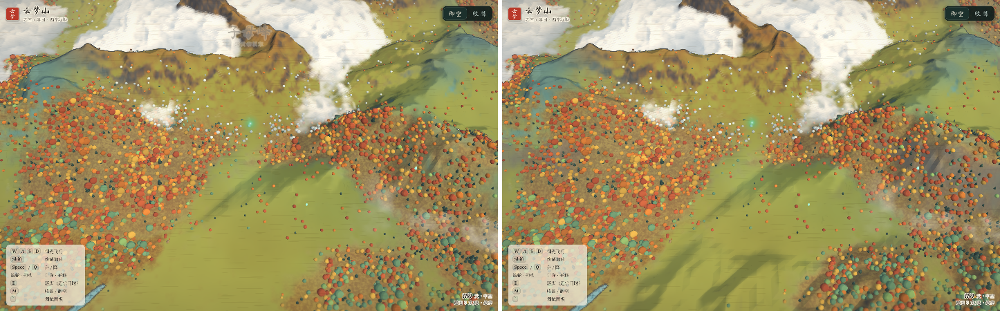

# 04 · The tools: plan → sculpt → read → hand-edit → fly



Requirements: Python 3.10+, numpy, **numba** (`pip install numba` — without it the solve is ~100× slower), Pillow
(optional; the PNG code falls back to its own reader/writer, which is what lets the same package run inside Blender's
Python). Everything is deterministic: same plan + same seed → same land.

## 1. Make a plan — `make_plan.py`

```bash
python3 tools/terrain/make_plan.py                 # → tools/terrain/plan/{lithology.png, geology.json}
python3 tools/terrain/make_plan.py --out my_plan   # a copy to paint on
```

`lithology.png` (1647 × 1002, 80 丈/px, cell-centred over the world rect) is the **rock map**. Paint it in Krita,
Photoshop, GIMP or Blender; colours snap to the nearest palette entry, so antialiased brushes are fine:

| rock | colour | rock | colour |
|---|---|---|---|
| alluvium 冲积层 | `#d8cf9c` (216, 207, 156) | red beds 丹霞红层 | `#c0583a` (192, 88, 58) |
| loess 黄土 | `#e0b870` (224, 184, 112) | limestone 石灰岩 | `#9fb3b6` (159, 179, 182) |
| metamorphic 变质岩 | `#8a8f7a` (138, 143, 122) | volcanic 火山岩 | `#5b4f57` (91, 79, 87) |
| granite 花岗岩 | `#c9c4bd` (201, 196, 189) | lacustrine 湖沼沉积 | `#6f7f4f` (111, 127, 79) |
| quartz sandstone 石英砂岩 | `#b9a98a` (185, 169, 138) | | |

`geology.json` holds what a raster cannot:

```jsonc
{
  "seed": 7,
  "structures": {
    "folds":   [{"name": "云梦褶皱带", "ellipse": [x, z, rx, rz, rot°], "strike": 15, "dip": 35, "bed": 300,
                 "wave": 9000, "amp": 300, "contrast": 0.6}],                 // or "poly": [[x, z]…]
    "faults":  [{"name": "…", "pts": [[x, z]…], "up": "N|S|E|W", "throw": 0.35, "width": 260, "reach": 6000,
                 "tip": 1500, "crush": 1.2}],
    "volcanoes": [{"name": "…", "x": 0, "z": 0, "r": 1000, "h": 290, "kind": "strato|caldera", "floor": 0.25}],
    "uplift":  [{"x": 0, "z": 0, "r": 2500, "du": 0.12},                     // a dome
                {"name": "…龙脉", "pts": [[x, z]…], "width": 900, "du": 0.3}],   // a ridge that keeps rising
    "glacier": {"ela": 650}
  },
  "operators": {"karst": {"tower_h": [20, 70]}, "pillars": {"minor": [78, 92]}},   // override any operator default
  "lithology": {"granite": {"K": 0.3, "Sc": 7}},                                  // override any rock parameter
  "regions": […]          // make_plan's own record of what it painted and why (not read by sculpt)
}
```

Coordinates are world 丈 (x east, z **south**, origin at the centre of the 云梦 three sects) — read them off the Godot
debug readout, the Blender importer (`--scale 0.1`: Blender x = x/10, y = −z/10) or `layout.json`.
All operator parameters and their defaults: `DEFAULTS` in `tools/terrain/xyterrain/landforms.py`; rock parameters:
`LITHO` in `xyterrain/geology.py` (table in [02 §1](02-landforms.md#1-the-engine-stream-power-with-rock)).

## 2. Sculpt — `sculpt.py`

```bash
python3 tools/terrain/sculpt.py                                  # plan/ → godot/data/terrain/ (+ preview/)
python3 tools/terrain/sculpt.py --steps 40                       # further from the exported land
python3 tools/terrain/sculpt.py --no-preserve                    # also reshape round the sects and cities
python3 tools/terrain/sculpt.py --no-operators --out /tmp/ero    # erosion only (to see what the operators add)
python3 tools/terrain/sculpt.py --steps 0 --out /tmp/ops         # operators only
```

~2½ min on the full 3296 × 2005 grid (numba; 24 steps ≈ 1 min of it). Output folder:

| file | what |
|---|---|
| `height_f16.bin`, `height.png`, `terrain.json` | the new 40-丈 heightfield — the same grid and formats as `data/world` (half floats LE / 16-bit PNG big-endian, `h = v/65535·max`) |
| `lithology.png` | rock id per height sample (8-bit) |
| `rocks.bin` | rock instances, float32 × 8: x, y (ground), z, radius, height, kind, yaw, var — kinds `karst_tower, sandstone_pillar, stone_blade, sea_stack, granite_spire, basalt_column, danxia_butte` |
| `layers/*.png` | `redness` (Danxia), `pillar_stage`, `karst_form`, `glacier` (8-bit, normalised) — for shaders and scattering |
| `preview/` | `before.png`, `after.png` (shaded relief tinted by rock, rock instances as dots) and `cmp_<place>.png` close-ups |

What stays fixed: every water cell (the 舆图's sea, lakes and rivers keep their beds) and the banks within two cells of
it (the engine cuts the ground away per pixel where the height reaches the water level, so the land must meet each river
at the exported height and rise only beyond), the six sect patch rects + 420 丈
(feathered over 900), the city cores (1 700 丈) and the landmarks (450 丈) — the engine's sect, city and landmark meshes
sit there. Trees are stored without heights (`trees.bin`), so they re-seat on the new ground by themselves.


## 3. Close-ups



*云梦山: the granite core sharpened, the limestone belt (blue) into fengcong cones with the 灵眼 天坑 kept, the
graben swamp (green), quartz sandstone joint gorges (right).*



*落云宗's 东脉 with pillar instances along the gorges; 百巧院's caldera rim; the 南山 cockpit karst above the 韵州
plain; 鸾鸣宗's red-bed mesas; the islands as young volcanoes with radial gullies (Rho8), 灵龟 a caldera.*

## 4. Hand-edit in Blender — `terrain_edit.py` / `terrain_bake.py`

```bash
blender --python tools/blender/terrain_edit.py -- --site luoyun --half 3000 --terrain godot/data/terrain
#   sculpt (Draw / Clay Strips / Smooth / Flatten …) — keep the topology, no Dyntopo
#   paint rocks in Vertex Paint on the "Litho" colour attribute (palette above)
blender edit.blend --background --python tools/blender/terrain_bake.py          # writes back in place
blender edit.blend --background --python tools/blender/terrain_bake.py -- --out /tmp/t_edit --no-litho
```

The edit mesh has one vertex per height sample (exact round trip), the starting heights in the attribute `h0` (only
changed samples are written back, so a terrain re-sculpted since keeps everything else), and its placement in custom
properties. After Dyntopo/Remesh the bake ray-casts every sample instead. The Litho colours snap to rock ids and are
painted into the plan's `lithology.png`; re-run `sculpt.py` to grow the land from repainted rock. Verified: a 50-丈
dome sculpted on 落云宗 comes back as exactly +50.0 at the centre sample (292 samples changed), a painted 20 × 20-vertex
red-bed square repaints the 100 plan pixels under it.

Bigger reshaping is better done in the plan (rock, faults, ridges) and left to the solve; Blender is for the last 10 %
— a pass, a terrace, a lake shore.

## 5. Read the land — `fengshui.py`

```bash
python3 tools/terrain/fengshui.py                                   # the six sects, exported land
python3 tools/terrain/fengshui.py --terrain godot/data/terrain      # … re-sculpted
python3 tools/terrain/fengshui.py --trace luoyun                    # the 龙脉 route from the 祖山 and its col
python3 tools/terrain/fengshui.py --search luoyun --radius 6000     # better sites round 落云宗 + heatmap
```

```
site      total   向°   玄武   龙脉    砂    水   明堂   藏风   案朝    向    穴   祖山 col
古剑门      0.64  165 1.00 0.90 0.89 0.00 0.00 0.68 1.00 1.00 0.00   [-630, -3137, 1076] -8
落云宗      0.46  180 0.60 0.75 0.68 0.00 0.00 0.50 0.50 1.00 0.00   [-630, -3137, 1076] -26
…
```

**A worked iteration (how this plan got its 龙脉 ridge).** The first sculpts dropped 落云宗 from 0.45 to 0.35: its 龙脉
term went to 0, the col on its best ridge path to the 祖山 above 古剑门 falling from −29 丈 to −156 丈 below the site.
Erosion-only and operators-only runs (`--no-operators`, `--steps 0`) put the cause in the solve. Three causes, each a real
modelling fix: (1) the graben faults ran past the swamp and dropped a band across the range — **faults now die out at
their tips**; (2) uplift had been taken from the topography, so saddles were under-uplifted — **uplift is now a regional
massif field**; (3) north-flowing rivers still captured the divide — so the plan now draws the **云梦东脉 龙脉** as an
uplift ridge along the route `--trace` reported (south of 绿踪, its 过峡 the saddle at x ≈ 5000). Result: col −26, score
0.46. That loop — score, trace, fix the plan, re-sculpt — is the intended way to work.

## 6. Fly over it in Godot

```bash
godot --path godot -- --terrain=res://data/terrain     # or an absolute path to any sculpt.py output folder
godot --path godot -- --terrain=res://data/terrain --tour=/tmp/tour_new   # one screenshot per landform region, then quit
godot --path godot -- --tour=/tmp/tour_old                                # the same views on the exported land
```

`World` replaces the exported heights with the folder's `height_f16.bin` (same grid), loads `lithology.png` as the
global `t_litho` (the terrain shader tints bare rock by it: granite pale, red beds red, limestone blue-grey…) and
`rocks.gd` builds the rock instances from `rocks.bin` with the facet ink material (`rock_kit.gd`: procedural faceted
prisms per kind — replace them with Blender models in the same vertex layout). With a sculpted terrain the plain is
also shaded by its slope (the demo's plains were flat, so the port shaded everything below 30 丈 as level ground — fans,
terraces and low mesas would not show). Without `--terrain` the port runs the exported land exactly as before.

In the port (Compatibility renderer, `--tour`; left the exported land, right `--terrain=res://data/terrain`):


*子母峰 and the 东脉: the quartz-sandstone pillar forest stands round the demo's landmark.*


*落云宗 from the south: the pillars rising behind the sect's cloud basin.*


*鸾鸣宗's basin: red-bed hills stepped into mesas (the plain is shaded by its slope now, the red beds stain their soil).*


*南山 above 韵州: cockpit karst cones in clusters, the plain at the water table.*


*云梦山 from the south: the same ranges, more deeply dissected; granite pale on the bare walls.*


*百巧院: the caldera rim closing the 西脉 basin behind the maples.*

## 7. Extending

- **A new landform**: add a function `def myform(c, w)` in `landforms.py` (read `c.h`, `c.area`, `c.wet`, `c.X/Z`,
  blend your result by `w`, append rock instances with `c.add_rocks`), register it in `OPERATORS`, give a rock its
  `"op": "myform"` in `LITHO` (or add a rock with a new id and colour).
- **A new rock instance kind**: append to `ROCK_KINDS` (Python) and `RockKit.KINDS` / `SPEC` (GDScript) in the same order.
- **Other base data**: everything reads `World` (`xyterrain/world.py`), so a different export (another map) works as
  long as it has `meta.json`, `layout.json`, `places.json`, `height_f16.bin`, `water_mask.png`, `water_sd.png`.
- **Faster / more physics**: `flow.py` is ~200 lines; fastscapelib's eroders slot in for it ([05](05-other-projects.md) §4).
