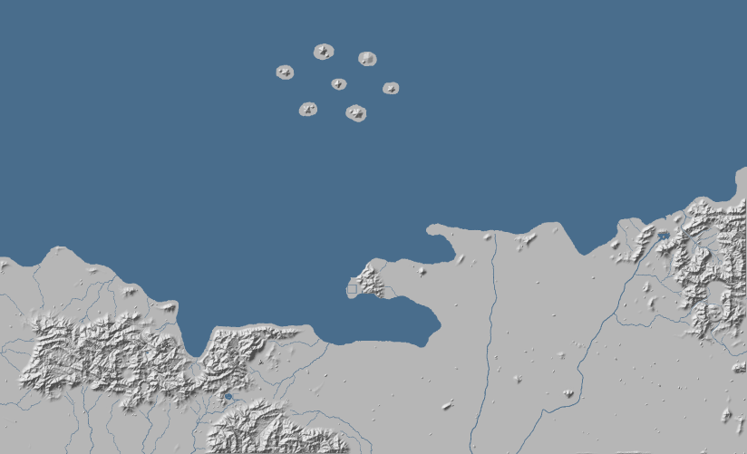
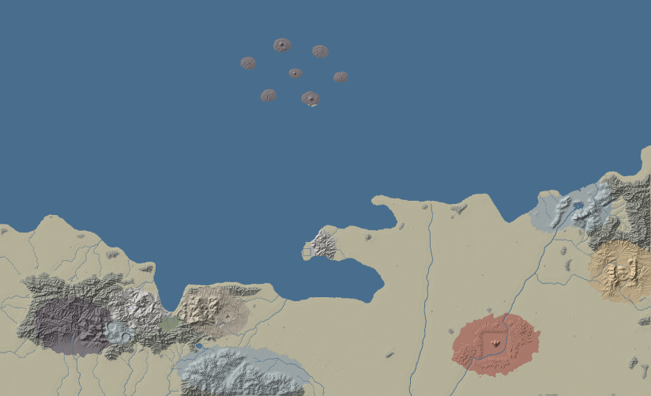

# Terrain & level editing — geology-driven, canon-aligned

How the map's land is made today, how to make it with real geological logic, and the tools that do it: a geological
**plan** you paint, a **sculpt** that grows the land from it by stream-power erosion and rock-specific landform operators,
a **feng-shui reader** that checks the sect sites, a **Blender round trip** for hand edits, and the **Godot** hook to fly
over the result.

| before (the demo's land) | after (`tools/terrain`, default plan) |
|---|---|
|  |  |

## Chapters

1. [The terrain today](01-current-system.md) — the layers (GEO → layout → 03a stream power → 03l sect styles →
   heightfield), what "editing" means now, what is good, what is missing (measured).
2. [Landforms with real geological logic](02-landforms.md) — the engine (U, K, Sc, Rho8), structures (folds, faults,
   龙脉 ridges), and a recipe per rock: granite, quartz-sandstone peak forest, Danxia, karst (峰丛 / 峰林), volcanic,
   loess, alluvial fans and terraces, swamps, glacial, coasts; the cloud sea; 皴法 and 郭熙's composition rules;
   feng shui as measurable criteria; a reality check of every size.
3. [The world plan](03-world-plan.md) — a geological history of 溪国 that explains every region, the rock and canon of
   each place (《凡人修仙传》: novel / handbook / wiki / donghua), spirit veins and spirit eyes on geology, the canon
   conflicts to decide, and next iterations per sect.
4. [The tools](04-tools.md) — `make_plan.py`, `sculpt.py`, `fengshui.py`, Blender `terrain_edit.py` / `terrain_bake.py`,
   Godot `--terrain=`; file formats, the palette, a worked iteration.
5. [How other projects do it](05-other-projects.md) — Terrain3D, godot_voxel, fastscapelib, Landlab, Schott 2023/2024,
   Paris's rock and karst work, runevision's erosion filter, mapgen4, BlenderGIS + Copernicus DEMs, game pipelines; what
   we adopted and what to do next.

Research dossiers (sourced, with source tags): [tools & projects](research/r1_tools_projects.md) ·
[凡人修仙传 geography](research/r2_fanren_geography.md) · [landform geology, 皴法, 风水](research/r3_landform_geology.md).

## Quick start

```bash
pip install numpy numba pillow
python3 tools/terrain/make_plan.py          # the default plan (or edit tools/terrain/plan/ directly)
python3 tools/terrain/sculpt.py             # → godot/data/terrain/ (~2½ min)
python3 tools/terrain/fengshui.py --terrain godot/data/terrain
godot --path godot -- --terrain=res://data/terrain
```

## The ideas in one screen

- **Rivers first, rock decides.** The 舆图's rivers and coast are base level; each rock has its own erodibility and
  steepest stable slope, so granite stands high and sheer, alluvium lies low and flat — from one physics, not stamps.
- **Structure before form.** Fold belts (hogbacks, trellis valleys), faults (range fronts, a graben for 绿踪沼泽),
  volcanoes (百巧院's caldera, 七灵岛), and **龙脉 drawn as ridges that keep rising**.
- **Rock by rock.** 峰丛 above the water table and 峰林 at it; Wulingyuan pillars by joint stage; Danxia 顶平身陡麓缓;
  granite spires and domes; loess 塬 → 梁 → 峁; fans and terraces on the plains; U-troughs above the palaeo snow line.
- **Two scales.** The heightfield carries the ground; ~2 300 rock instances (towers, pillars, stacks, spires) carry what
  is thinner than two grid cells.
- **Canon on geology.** 灵脉 = deep structure (主脉 / 东脉 / 西脉 = granite core / quartz sandstone / volcanic west);
  灵眼 = where the deep comes up; the protective mist = the basin's inversion fog; sects sit 背山面水 on a dragon vein —
  and the camera, always facing north, sees every south-facing sect from the front.
